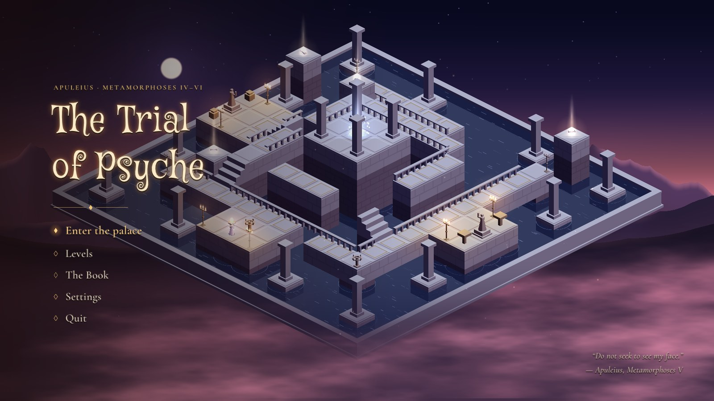
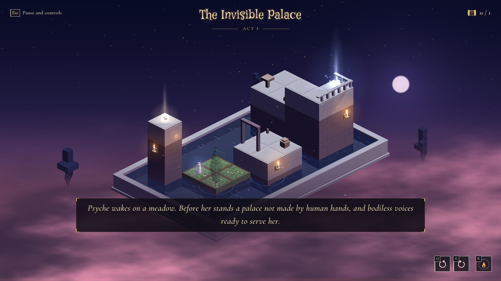
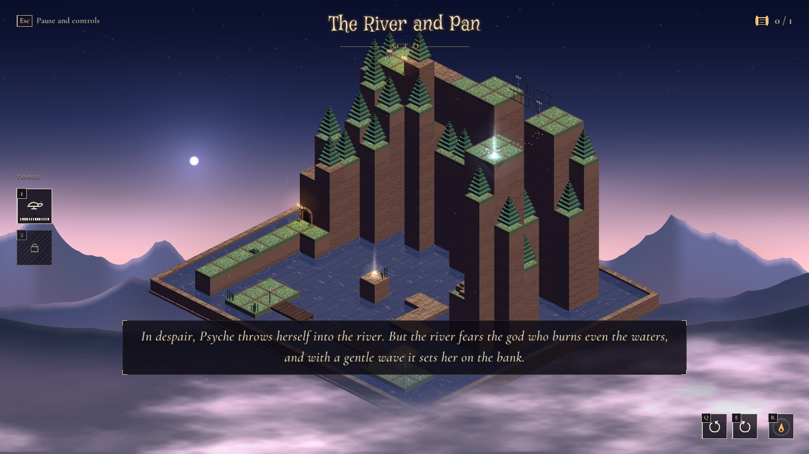
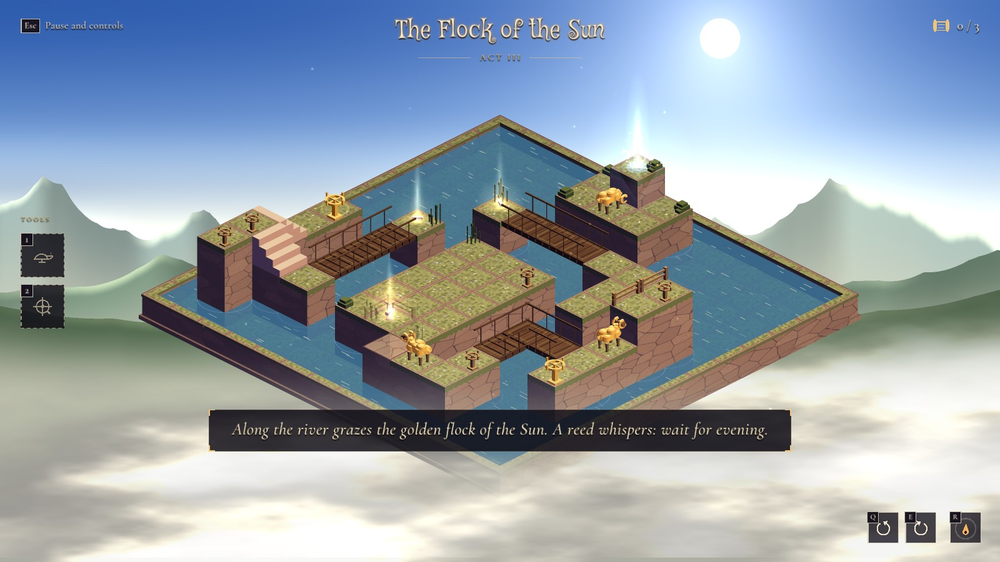
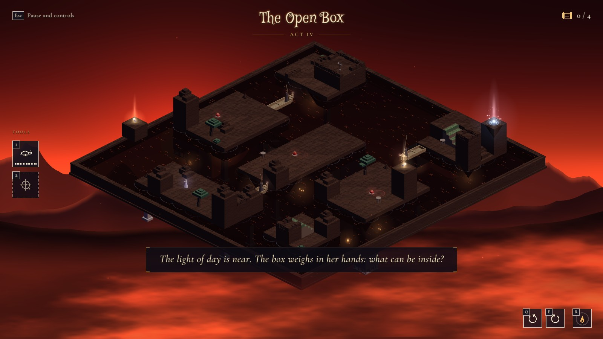
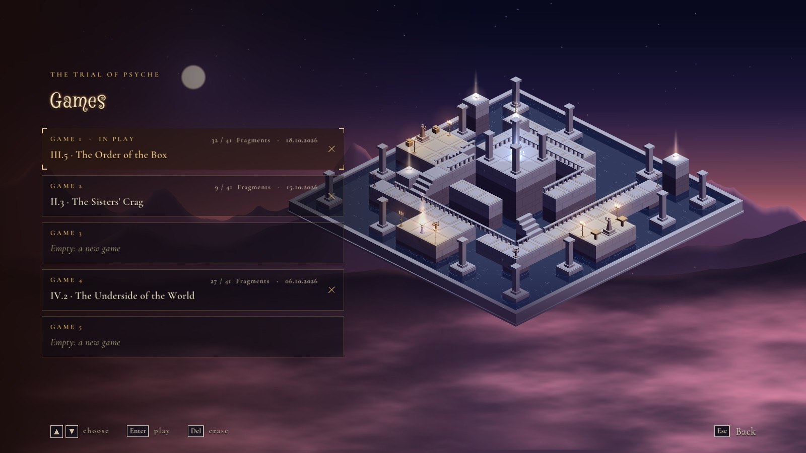
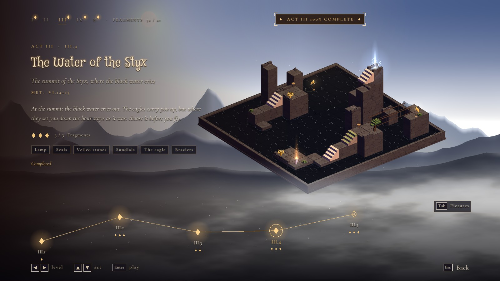

# The Trial of Psyche

*An isometric puzzle about seeing and trusting, 
from Apuleius' tale of Cupid and Psyche.*

  

  

 

An oracle sends Psyche to a lonely crag, dressed for a wedding of death. The wind
carries her to an invisible palace, where a husband she must never see comes to
her every night. Then come the sisters, a lamp, a drop of oil — and the long road
to win him back.

> **In the dark, what looks joined *is* joined.**

Turn the diorama and two stones that only *seem* to touch become a bridge. Light
the lamp and the truth shows — until the oil runs out. Later the spindle turns
parts of the palace, and even the time of day, and Jupiter's eagle carries her
where no road goes. In the underworld it turns the whole world over, onto
Proserpina's kingdom hanging beneath it, and Charon ferries her across the dark
water.

Every place is a small world of its own, standing in its basin over the clouds:
marble for the palaces, living rock for the crags, earth for the woods.

Everything you see and hear is made by code: the pieces, the sky, the music and
every sound, footsteps included. There is not a single image or audio file in the
game.

Four acts and an epilogue, in Italian and English, with hidden fragments of the
tale to gather in the Book. It will be released once the whole tale is told.

<table>
<tr>
<td width="50%"> <i>Act I · The Invisible Palace</i></td>
<td width="50%"> <i>Act II · The River and Pan</i></td>
</tr>
<tr>
<td> <i>Act III · The Flock of the Sun</i></td>
<td> <i>Act IV · The Open Box</i></td>
</tr>
</table>

Up to five games side by side, each to continue, restart or erase; the levels of
each act as pictures or as a constellation, a star per level, lit where the tale
has gone on.

<table>
<tr>
<td width="50%"> <i>Five games side by side</i></td>
<td width="50%"> <i>An act as a constellation</i></td>
</tr>
</table>

What changed, step by step: the [changelog](https://trialofpsyche.com/changelog).

## Controls

| | Keyboard and mouse | Gamepad |
|---|---|---|
| walk | click | left stick or d-pad |
| turn the diorama | Q / E | LB / RB |
| the lamp (hold) | 1, L or right click | LT |
| the spindle (on a handle or a sundial) | 2, F or a click on Psyche | RT |
| into a cave · call the eagle | Space | A |
| back to the last brazier · hold: restart | R | B |
| where is Psyche? | Tab | Y |
| skip a cutscene (hold) | Space or Enter | A or B |
| levels: pictures or constellation | Tab | Y |
| erase a game | Del | X |
| pause | Esc | Start |

## License

Free software under the [GNU GPL v3.0](LICENSE). Fonts under the SIL Open Font
License. Made in [Odin](https://odin-lang.org) and [raylib](https://www.raylib.com), with
[Claude Code](https://claude.com/claude-code) as a coding copilot.

 

