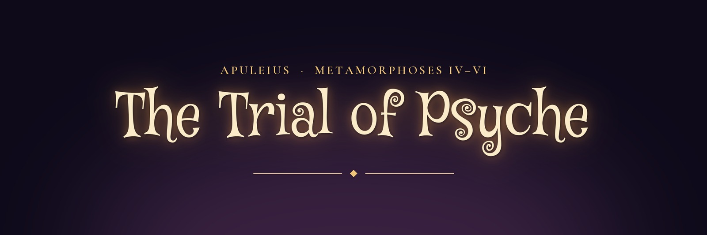
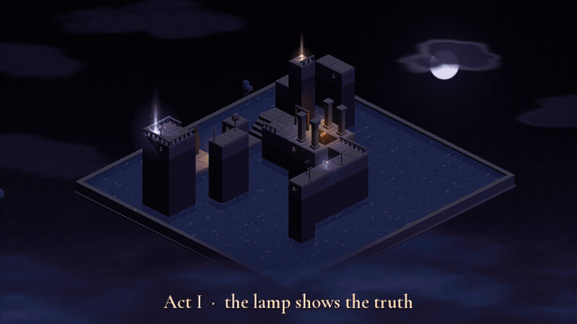
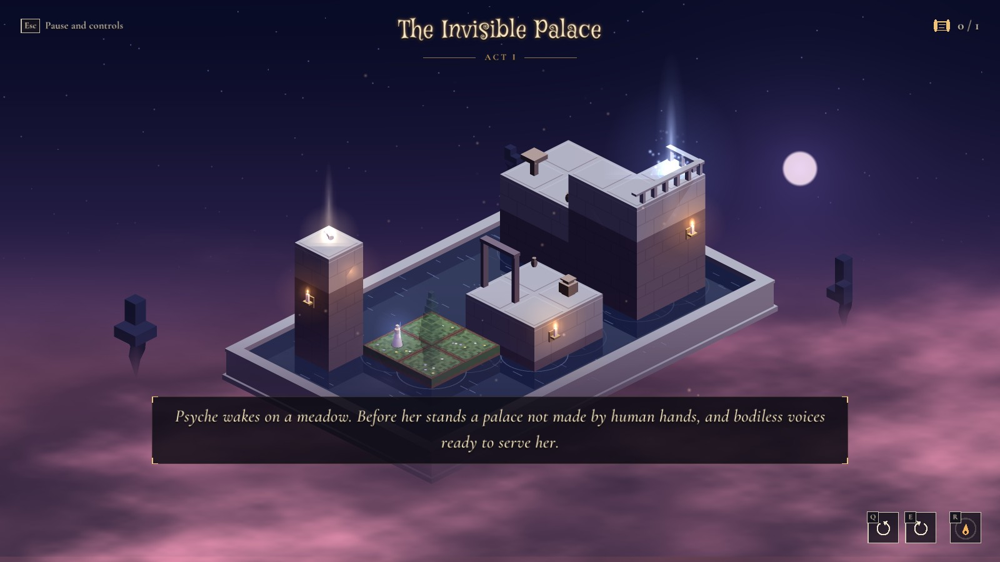
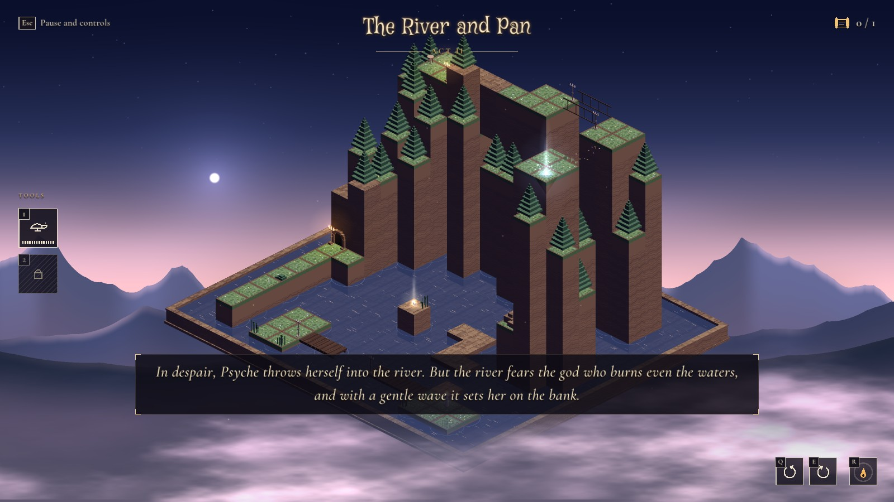
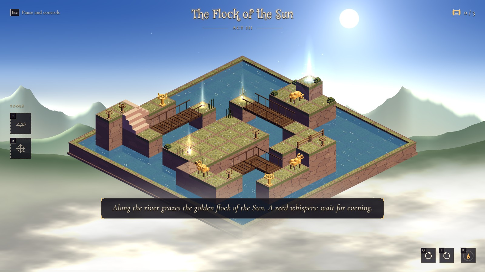
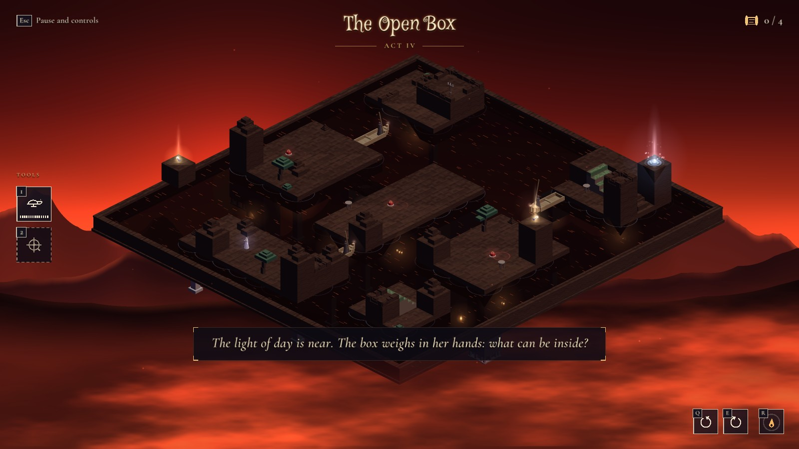
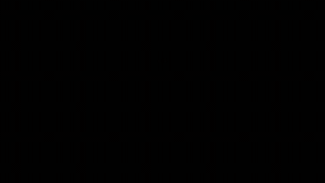
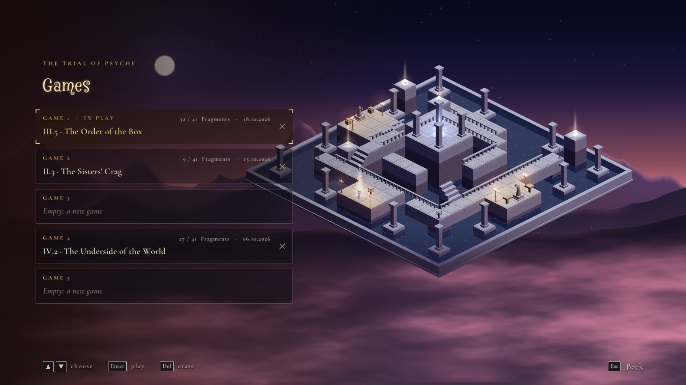
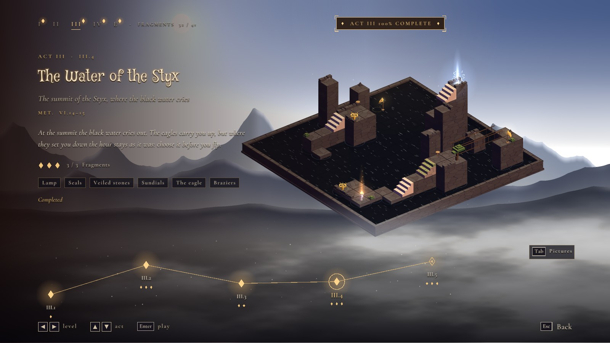

<div align="center">



*An isometric puzzle about seeing and trusting,<br>
from Apuleius' tale of Cupid and Psyche.*


<a href="LICENSE"></a>

<br><br>



<br><br>

<a href="https://github.com/pankaspe/the-trial-of-psyche/releases/tag/v0.9.0-beta"></a>
<a href="https://trialofpsyche.com/changelog"></a>

</div>

<br>

An oracle sends Psyche to a lonely crag, dressed for a wedding of death. The wind
carries her to an invisible palace, where a husband she must never see comes to
her every night. Then come the sisters, a lamp, a drop of oil — and the long road
to win him back.

> **In the dark, what looks joined *is* joined.**

Turn the diorama and two stones that only *seem* to touch become a bridge. Light
the lamp and the truth shows — until the oil runs out. Later the spindle turns
parts of the palace, and even the time of day, and Jupiter's eagle carries her
where no road goes. In the underworld it turns the whole world over, onto
Proserpina's kingdom hanging beneath it, and Charon ferries her across the dark
water. At the end of the road, Olympus.

Every place is a small world of its own, standing in its basin over the clouds:
marble for the palaces, living rock for the crags, earth for the woods.

Everything you see and hear is made by code: the pieces, the sky, the music and
every sound, footsteps included. There is not a single image or audio file in the
game.

Four acts and an epilogue, in Italian and English, with hidden fragments of the
tale to gather in the Book. The whole tale is now told, from the oracle to the
wedding on Olympus.

## Play the beta

The [public beta](https://github.com/pankaspe/the-trial-of-psyche/releases/tag/v0.9.0-beta)
holds the whole game. Download the archive, unpack it and run `./trial-of-psyche`:
Linux x86_64 (glibc 2.29 or newer, Ubuntu 20.04+, Debian 11+, Fedora, Arch,
SteamOS...), OpenGL 3.3, nothing to install. Nothing is final yet: texts, balance
and some levels may still change. Where you got stuck, what was unclear, how it
runs on your machine: [leave a playtest note](https://github.com/pankaspe/the-trial-of-psyche/issues/new/choose).

<table>
<tr>
<td width="50%"><br><sub><i>Act I · The Invisible Palace</i></sub></td>
<td width="50%"><br><sub><i>Act II · The River and Pan</i></sub></td>
</tr>
<tr>
<td><br><sub><i>Act III · The Flock of the Sun</i></sub></td>
<td><br><sub><i>Act IV · The Open Box</i></sub></td>
</tr>
</table>

The game opens in the dark: press a key and the lamp lights the way in. In the
menus the lamp's flame follows your choice, and the profile gathers what Psyche
has found so far (levels, fragments, achievements, the Notebook), with the Book
and the games a door away.



Up to five games side by side, each to continue, restart or erase; the levels of
each act as pictures or as a constellation, a star per level, lit where the tale
has gone on.

<table>
<tr>
<td width="50%"><br><sub><i>Five games side by side</i></sub></td>
<td width="50%"><br><sub><i>An act as a constellation</i></sub></td>
</tr>
</table>

What changed, step by step: the [changelog](https://trialofpsyche.com/changelog).

## Made only of code

The game is also an experiment: how far can a game go with **no assets at all**?
Not a texture, not a sprite, not a sound file. Everything is described in code and
made when the game starts:

- **the world**: every stone, stair, column and tree is a list of boxes turned into
  a mesh; the figures too (Psyche a turned profile, Cupid pure light, the rams, the
  eagle, Charon and his boat);
- **the light and the sky**: about a thousand lines of shaders paint the stones'
  marble and masonry, the skies, the mountain ranges, the clouds, the water, the
  lava, the seam between the two worlds;
- **the sound**: the music is generative (a plucked lyre, a flute, pads, glass
  bells, a long hall reverb) and every effect is synthesised, footsteps included;
- **the levels**: twenty small text files, one line per piece.

The only things the game did not make itself are its two fonts (under the SIL Open
Font License).

| | |
|---|---|
| the whole game | one 4.5 MB file, nothing to install (a 1.7 MB archive) |
| embedded in it | 20 levels (208 KB of text), shaders (68 KB), two fonts (920 KB) |
| code | about 26,000 lines of [Odin](https://odin-lang.org), plus 3,300 of tools and tests |
| graphics | true 3D with a depth buffer, built once per level; four quality levels, from a smaller canvas to 2x supersampling |
| memory | about 290 MB while playing at 1080p, the graphics driver included |

A level checker solves every diorama, move by move, before it ships: it finds the
plan with the fewest decisions, marks the dead ends, proves every fragment
reachable and optional, tells which pieces are really needed, and the tests play
every level's solution to the end.

## Controls

| | Keyboard and mouse | Gamepad |
|---|---|---|
| walk | click | left stick or d-pad |
| turn the diorama | Q / E | LB / RB |
| the lamp (hold) | 1, L or right click | LT |
| the spindle (on a handle or a sundial) | 2, F or a click on Psyche | RT |
| into a cave · call the eagle | Space | A |
| back to the last brazier · hold: restart | R | B |
| where is Psyche? | Tab | Y |
| Psyche's Notebook: the mechanics met so far | C | X |
| skip a cutscene (hold) | Space or Enter | A or B |
| levels: pictures or constellation | Tab | Y |
| erase a game | Del | X |
| pause | Esc | Start |

## Build from source

The beta's download is for Linux x86_64 only, but the game is plain
[Odin](https://odin-lang.org) and [raylib](https://www.raylib.com), so it should also
build on Windows, macOS and Linux on ARM. Those builds are **not tested yet**: if you
try one, a [playtest note](https://github.com/pankaspe/the-trial-of-psyche/issues/new/choose)
on how it went (even "it doesn't build") helps a lot.

1. Install Odin **dev-2026-10** or newer ([how](https://odin-lang.org/docs/install/)).
   It already includes raylib 6, the only library the game needs; nothing else to
   download.
2. Get the source and build it, from the repository's folder:

   ```sh
   git clone https://github.com/pankaspe/the-trial-of-psyche.git
   cd the-trial-of-psyche
   odin build src -out:trial-of-psyche -o:speed        # Linux, macOS
   odin build src -out:trial-of-psyche.exe -o:speed    # Windows
   ```

3. Run `./trial-of-psyche` (`trial-of-psyche.exe` on Windows). The levels, shaders
   and fonts are inside the binary: it can be moved anywhere on its own.

On Linux the X11 development files are needed for linking (`libx11-dev` on
Debian/Ubuntu, `libX11-devel` on Fedora). You need a GPU with OpenGL 3.3. Saves
and settings go to the system's usual folder for settings (`~/.config/` on
Linux, `%APPDATA%` on Windows, `~/Library/Application Support/` on macOS), under
`the-trial-of-psyche`.

## License

Free software under the [GNU GPL v3.0](LICENSE). Fonts under the SIL Open Font
License. Made in [Odin](https://odin-lang.org) and [raylib](https://www.raylib.com), with
[Claude Code](https://claude.com/claude-code) as a coding copilot.
