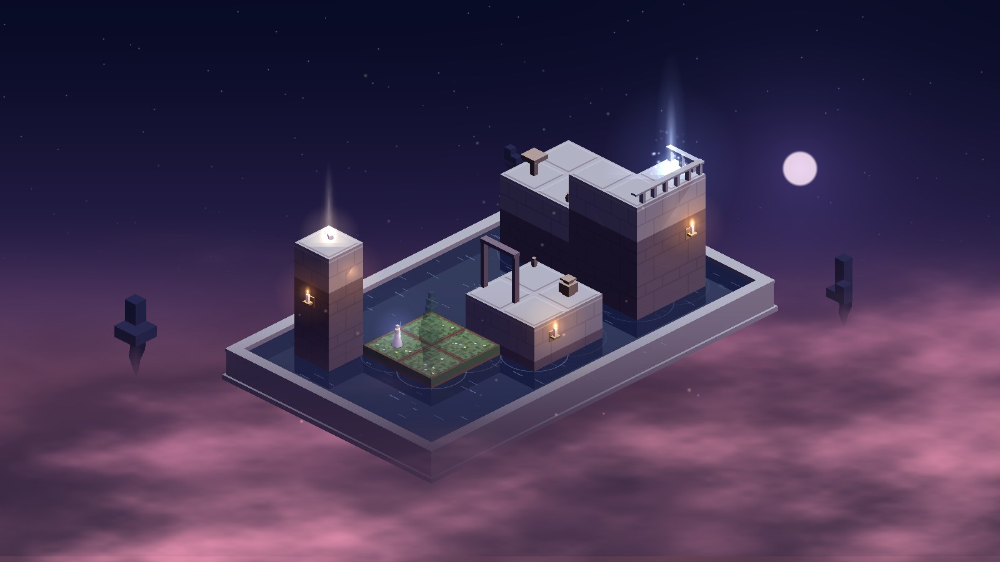
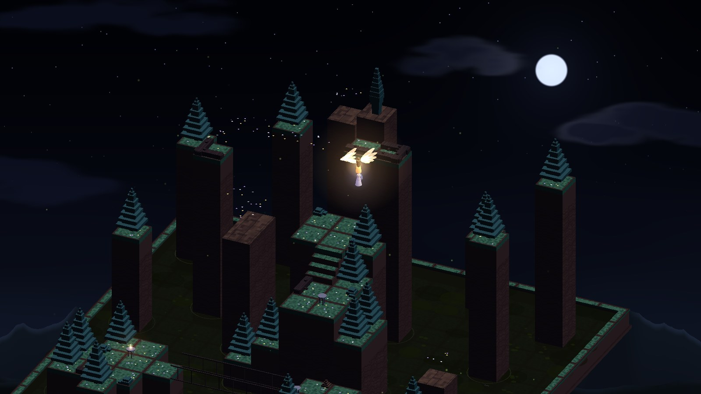
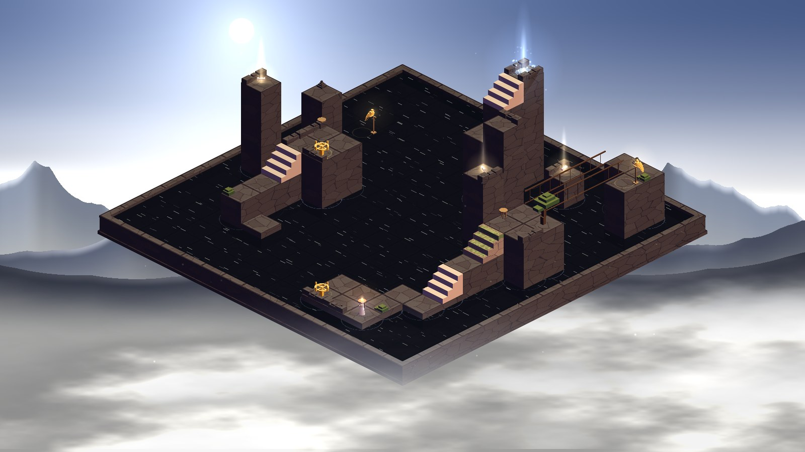
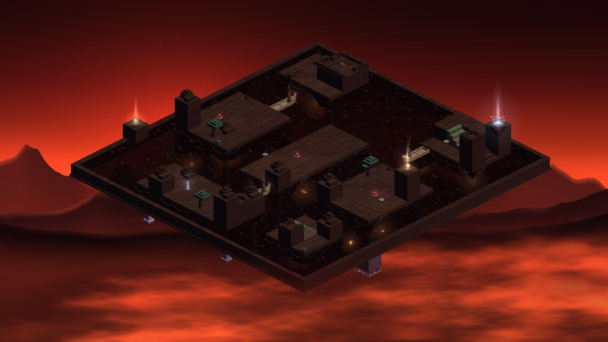
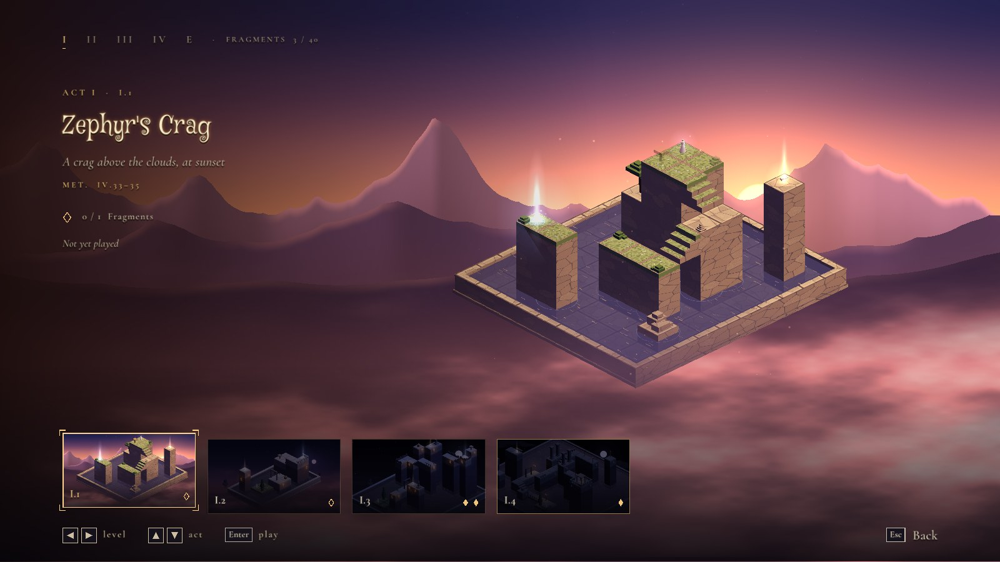
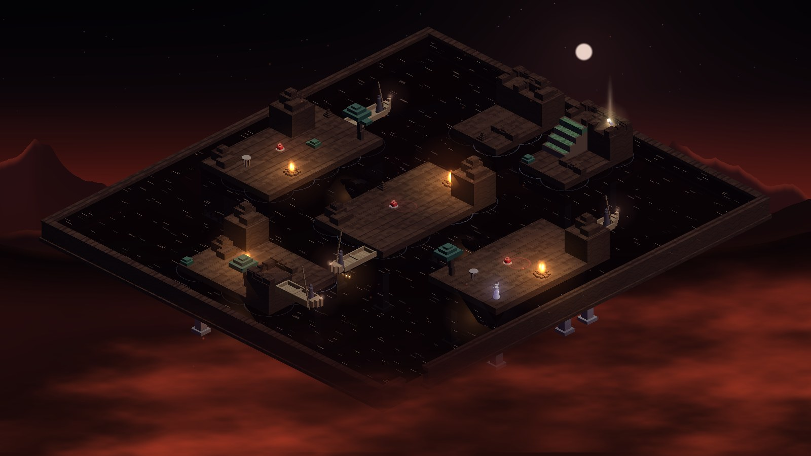
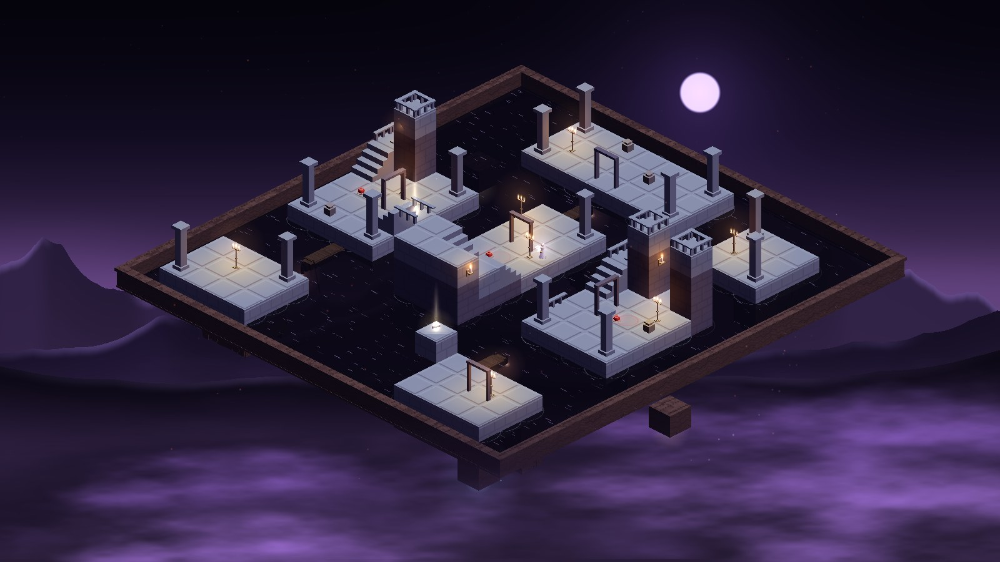

# The Trial of Psyche — Devlog

*October 16, 2026*

## How it started

In twelve days (October 4–16, 2026) a Godot prototype became a full game in Odin + raylib:
four acts, 19 levels, more than 100 commits.

The idea: an isometric puzzle in the style of Monument Valley, set in the tale of Cupid and
Psyche (Apuleius, *Metamorphoses* IV–VI). Psyche crosses floating dioramas where whatever
*looks* joined in the dark is joined. The Godot prototype, `lucerna`, proved the illusions
worked; on October 4 everything started again from scratch in Odin, with raylib 6 for the
window, input and GPU.

Three rules were set on day one and never changed:

- **Everything generated in code**: meshes, sky, figures, music, every sound (the footsteps
  too). `assets/` holds only levels, shaders and fonts.
- **Little text, gameplay first**: a cutscene opens each act, one line per level, a card at
  the end.
- **One level at a time**: build it, play it, judge it, then the next.

## The engine

The core is a single rule: two surfaces that *appear* joined in the current view are joined.
The rest of the engine exists to make that true, drawable and provable.

- **True 3D with the prototype's isometric projection**: `X = (x'−y')·64`,
  `Y = (x'+y')·32 − z'·64`, with a z-buffer and continuous rotation. Every illusion survives
  in 3D.
- **Pieces are lists of boxes**, uploaded once; a single shader recolours stone, marble, rock
  and bronze for each setting, with up to 16 flames lighting the stones.
- **The palace graph** is rebuilt on every turn (Q/E): illusions become edges, and hidden
  stairs count only when every tread is visible.
- **A solver** explores every state (cell, view, lamp, seals, handles, time of day, world)
  and finds the plan with the fewest decisions. `./build.sh check` uses it to prove that each
  level can be solved, that every piece is needed and that fragments are optional; in game, on
  a worker thread, it spots dead ends and tells the player.
- **Synthesised sound**: generative music per act (a Karplus–Strong lyre, flute, bells, pads),
  ambient beds per place, effects and footsteps computed on a worker thread.
- **A sealed save** (ChaCha20-Poly1305), 100% playable on keyboard or gamepad, from 720p to 4K.

## Act I — The Palace

Act I was done on October 5: four levels that teach you how to look, from Zephyr's Crag to
the night of the lamp.

*I.2 — The Invisible Palace: one seam per view.*

- **Turning** (Q/E): four views about the centre; it changes which surfaces touch.
- **Hidden stairs**: in the dark they work only when every tread is visible.
- **The lamp** (I.4): while it burns it shows the real edges and the cracks where the
  illusions were, and it uses up oil.
- **Seals**: the lamp lit over a seal raises a bridge.

The Oracle's cutscene opens I.1; I.4 has two endings, the canonical drop of oil and a secret
one, "Trust".

## Act II — The Abandonment

Act II brings the second tool, the **Spindle**, and the first pieces that change the diorama
under Psyche's feet.

*II.1 — Cupid's Flight: veiled planks among the pillars of the forest.*

- **Veiled stones**: absent in the dark, golden ghosts in the light, real for good near her.
- **The Spindle and handles**: standing on a handle, the spindle turns a part of the diorama
  a quarter turn.
- **Caves**: passages between sections, entered only on purpose.
- **Braziers**: places to go back to.

At first the act had five levels and two mechanics later dropped (crumbling stones, phantom
stones). On October 9 II.4 and II.5 became a single temple of Ceres and Juno: 101 steps,
11 handles. In the same days the sound was redone: no outside tracks, only generative music
and a synthesised flute, "like a dream".

## Act III — Venus's Trials

Act III is where the game found its shape: on October 11 the **two tools, three modifiers**
refactor replaced "one skill per act". The Lamp and the Spindle stay the only two buttons;
the place decides what they do.

*III.4 — The Water of the Styx: light at evening, fly by day.*

- **The sundial**: the Spindle turns the hour. By day the sun shows the truth as the lamp
  does but makes nothing real; at evening the illusions come back.
- **The Sun's rams**: standing by day, lying down at evening as steps.
- **Stairs of the sun**: they stand only by day and crumble at sunset.
- **Jupiter's eagle**: with Space it carries Psyche to a landing no sundial reaches.

From here on difficulty comes from fusing the pieces: III.4 has 54 steps and 11 decisions,
III.5 (the finale) 64 steps and 12 decisions over 63,800 states. A solver trick (parts that
are the same turned half way counted once) took III.2 from 135,000 states to 4,000.

## Act IV — The Underworld

Act IV, the longest with six levels, was finished on October 16: Psyche goes down from the
tower of Taenarus to Proserpina's kingdom and comes back with the box.

*IV.6 — The Open Box: the act's finale, 81 steps and 15 decisions.*

- **Proserpina's flip**: on a pomegranate, the Spindle turns the world over about an axle.
  A second world hangs under the palace, Proserpina's marble kingdom, and the axle's layer is
  one floor walked on from both sides.
- **Charon's boat**: first IV.1's exit, then a ferry between two landings that stays where it
  took her (IV.4–IV.6).
- **The guard candelabrum**: a seal that shows the stones across a dark stretch.
- **The box** (IV.6): at the exit the camera closes in, the lid lifts, the Stygian sleep pours
  out and Psyche falls asleep.

IV.1 is a tower of Babel widening as it falls, the sky fading from dusk to the red of the
underworld. In IV.6 each world has its own soul: crags and pines above, a temple of pillars
and urns below. Only the epilogue is left.

## Levels — the screen refactor

On October 15 the level select was redone: instead of a list, the chosen level is the real
diorama, asleep in the background.

- **The diorama behind**: the chosen level is actually loaded, framed on the right and turning
  slowly, with its own sky and sound. Changing the choice dims the world out and back in.
- **The left panel**: act, title, place, the chapters in Apuleius, the opening line, the
  fragments found and what the place holds (lamp, seals, handles, sundials, eagle, boat…),
  read from the level file rather than written by hand.
- **The pictures below**: the act's levels drawn once per session from a level loaded apart,
  one per frame, without stalling the interface.
- **Controls**: ← → level, ↑ ↓ or LB/RB act, Enter or South to play; the mouse chooses by
  hovering a picture.

The same day the look became **one side panel** shared by the levels, the settings and the
Book: the lamp's side darkened, tabs in capitals along the top, the controls at the foot,
"[Esc] Back" in the corner. The frosted glass of the old settings, with its blur shader, was
removed.

## A basin for every diorama

Later on October 16, before the playtest, a pass of coherence across all the levels: the first
acts floated over the void while the later ones stood in water. Now every place stands on
something of its own.

*IV.5 — The Way Back, by night: the land of the dead under a cold moon, fires on the islands.*

- **The basin**: a low wall on a plinth around the diorama, water inside. Its rim is marble for
  the palaces and temples, living rock for the crags and the Styx, earth for the woods and the
  pasture; the whole diorama stays inside it (the level loader refuses anything on the rim).
- **The fluid**: water coloured by the setting (blue at night, rose at sunset, black on the
  Styx), or a swamp, still and dark, with algae and slow bubbles (II.1).
- **The underworld**: where the world turns over the basin has no bottom, so Proserpina's
  kingdom still hangs beneath it; the rim opens where Charon's boat leaves. IV.2 and IV.3 keep
  their void: there it *is* the hanging world.
- **Two souls**: IV.4 and IV.5 took IV.6's crags above and temple below, every piece kept only
  if the solver's plans stayed the same; IV.5 went to night, with fires that light the stones
  and crackle as she passes, and Charon's boats are now pale wood against the dark.

*IV.6 turned over: Proserpina's temple, pillars and candelabra under a violet sky.*
